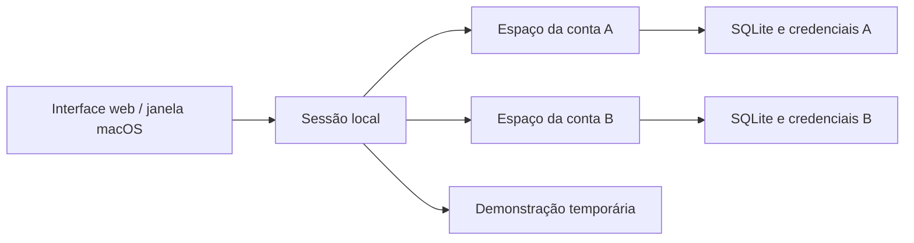

# Meu Dinheiro: estudo de caso

## Problema

Organizar conta corrente, cartão e investimentos exige conciliar fontes com datas e formatos diferentes. Uma transferência entre contas próprias pode parecer uma receita nova; o pagamento da fatura pode duplicar uma despesa já detalhada; parcelas podem repetir a data original da compra em meses diferentes.

## Solução demonstrável

Uma aplicação Python com interface web e pacote macOS, importação revisável, integrações bancárias, gráficos, planejamento de reserva e IA com fontes e revisão humana. A demonstração oferece um histórico fictício que pode ser alterado sem conectar bancos ou enviar informações à IA.

## Decisões técnicas

- **Contas locais isoladas:** cada usuário recebe seu próprio SQLite e sua própria pasta de credenciais. A sessão define o espaço de dados no servidor; IDs enviados pelo cliente não escolhem outra conta.
- **Compatibilidade do histórico:** a identidade e os arquivos da conta principal existente são preservados. Cadastro novo não transfere os dados antigos para outro usuário.
- **Conciliação explícita:** importações têm prévia, backup, revisão e regras para evitar contar pagamentos e transferências novamente.
- **IA como apoio:** classificações aprendem com decisões manuais. Notícias incluem fontes; a personalização financeira acontece numa chamada sem busca web.
- **Entrega desktop:** a janela WebKit inicia um backend local empacotado. Dados ficam fora do aplicativo distribuído.

## Como apresentar em dois minutos

1. Entre na demonstração e mostre os gastos mensais por categoria e por origem.
2. Edite uma categoria e explique a revisão humana e o aprendizado local.
3. Mostre o plano de reserva e como alterações de aporte mudam o prazo.
4. Abra Notícias e explique a diferença entre uma notícia, sua interpretação e uma sugestão condicional.
5. Mostre os testes de isolamento e o pacote macOS, sem expor arquivos reais.

## Limites desta versão

Cadastro e sessões são locais, sem recuperação por e-mail. O banco não possui criptografia integral. A prévia desktop ainda precisa de assinatura Developer ID/notarização para uma distribuição pública convencional. Integrações reais dependem de credenciais e permissões do provedor. O repositório e o instalador não incluem dados pessoais.

## Contribuição e uso de IA

O projeto foi desenvolvido com apoio de IA para implementação e investigação. Ao apresentá-lo, explique quais problemas e decisões você conduziu, como revisou as sugestões, como verificou os resultados e quais partes consegue manter. Os testes e as demonstrações sustentam as afirmações técnicas; textos gerados por IA não substituem essa verificação.
