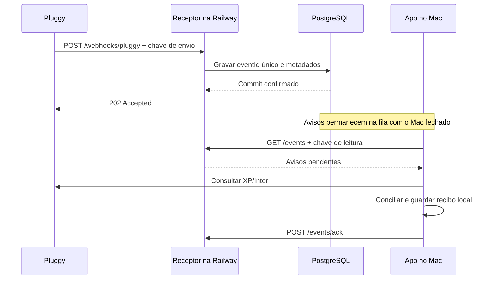

# Webhooks da Pluggy na Railway

Um webhook é um aviso enviado por HTTP. A Railway guarda o aviso; o Mac consulta os dados financeiros diretamente na Pluggy quando o aplicativo está aberto e desbloqueado.



## Publicar na Railway

1. Crie uma conta e um projeto na [Railway](https://railway.com). Confira os créditos e o plano antes de contratar: [preços](https://railway.com/pricing).
2. Adicione PostgreSQL ao projeto. Use a rede privada; o Mac não precisa acessar esse banco.
3. Adicione um serviço pelo repositório **marcosrampaso/meu-dinheiro**, branch `main`. Na autorização do GitHub, limite a Railway a esse repositório.
4. Em Settings do receptor: **Root Directory = `/relay`**, **Railway Config File = `/relay/railway.toml`**, **Watch Paths = `/relay/**`**. O Dockerfile copia somente o receptor.
5. No app local, abra **Configurações → Avisos da Pluggy → Preparar a Railway** e clique em **Gerar / renovar chaves do receptor**. Copie as três variáveis para **Variables** do serviço receptor. Guarde as chaves fora do GitHub e do chat.
6. Adicione `DATABASE_URL = ${{Postgres.DATABASE_URL}}`, adaptando `Postgres` ao nome do banco. A Railway define `PORT`; o Dockerfile escuta essa porta. O healthcheck `/health` verifica o banco.
7. Publique e aguarde o estado saudável. Em **Settings → Networking → Generate Domain**, obtenha a URL HTTPS.
8. Salve essa URL no app local, marque **Sincronizar ao receber avisos** e clique em **Registrar avisos na Pluggy**. A repetição atualiza os webhooks dessa URL em vez de criar cópias.
9. Atualize uma conexão no Meu Pluggy. Quando a coleta terminar, abra o app, desbloqueie com Touch ID e use **Conferir avisos agora**. O quadro identifica a conexão processada.

Referências: [FastAPI na Railway](https://docs.railway.com/guides/fastapi), [subpastas](https://docs.railway.com/deployments/monorepo), [PostgreSQL](https://docs.railway.com/databases/postgresql), [webhooks da Pluggy](https://docs.pluggy.ai/en/reference/webhooks).

## Dados e acesso

| Lugar | Conteúdo |
|---|---|
| Railway | eventId, itemId, tipo, origem e horários; PostgreSQL persiste a fila entre reinícios |
| Mac | Valores, lançamentos, posições, arquivos, categorias e credenciais de consulta à Pluggy |
| Pluggy | Conexões autorizadas e configuração dos webhooks, incluindo a chave de envio |

O receptor descarta outros campos do corpo recebido. Ele não consulta contas. `RELAY_ITEM_IDS` limita as conexões autorizadas. Duas chaves distintas separam envio e leitura; corpos acima de 32 KB são recusados, respostas não ficam em cache e logs HTTP de acesso estão desativados. As chaves geradas só aparecem pela ação explícita de geração; o status não as devolve. O cabeçalho personalizado segue a API oficial; esta implementação não pressupõe assinatura HMAC da Pluggy.

| Rota | Autorização | Função |
|---|---|---|
| `GET /health` | Pública | Disponibilidade do banco, sem dados pessoais |
| `POST /webhooks/pluggy` | `X-Webhook-Key: RELAY_INGEST_TOKEN` | Gravar aviso validado |
| `GET /events` | `Authorization: Bearer RELAY_READ_TOKEN` | Até 100 avisos pendentes |
| `POST /events/ack` | Mesma chave de leitura | Confirmar até 100 eventIds |

## Repetições e falhas

- A restrição única de `eventId` funciona também com entregas simultâneas e várias instâncias do receptor compartilhando PostgreSQL. Esta versão tem um consumidor: este Mac.
- O receptor confirma depois do commit. Falha do banco devolve `503`. A Pluggy exige resposta em dez segundos e tem tentativas limitadas; confira no Dashboard eventos que não chegaram.
- O app consulta a fila a cada minuto, com página visível e sessão Touch ID válida. Agrupa avisos da mesma conexão e consulta uma vez os dados atuais.
- Falha de sincronização mantém o aviso pendente. Falha apenas na confirmação da fila é recuperada pelo recibo local, sem repetir a consulta concluída.
- Uma queda entre gravação financeira e recibo pode repetir a sincronização. Os importadores conciliam pelos IDs e substituem o período autorizado sem somar outra cópia.
- Prévias manuais anteriores a uma sincronização nova são recusadas. Faturas históricas do Inter continuam preservadas; a XP guarda a posição para o rendimento.
- Erros, pedidos de autenticação e exclusões de conexão geram avisos ao usuário sem apagar o histórico local.
- Desconectar no Mac pausa o consumo. Para encerrar os avisos na nuvem, remova os webhooks no Dashboard da Pluggy. Metadados confirmados ficam no banco para reconhecer reentregas.

## Testar

Na raiz do repositório:

```sh
.venv/bin/python -m pip install -r requirements-dev.txt
.venv/bin/python -m unittest discover -s tests -q
docker build -t meu-dinheiro-relay relay
```

O contrato HTTP usa SQLite temporário nos testes normais; a aplicação hospedada exige PostgreSQL. Para testar também durabilidade e concorrência, use um banco descartável `financas_webhook_test`, em `127.0.0.1`, e defina `WEBHOOK_TEST_DATABASE_URL`. O teste limpa a tabela de eventos desse banco de testes. Não use produção.

Para executar fora do Docker, configure as quatro variáveis de `relay/.env.example` no ambiente e rode:

```sh
.venv/bin/python -m uvicorn relay.app:app --host 127.0.0.1 --port 8080 --no-access-log
```

O `.env` não é carregado automaticamente. Na Railway, use **Variables**. No Mac, a configuração fica em `data/pluggy-relay.json`, com permissão `0600` e ignorada pelo Git.
